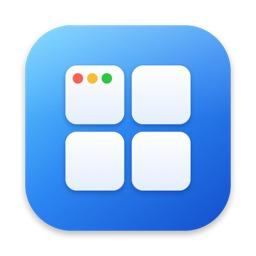
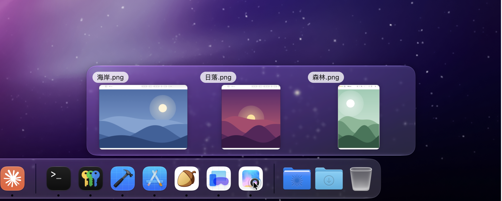
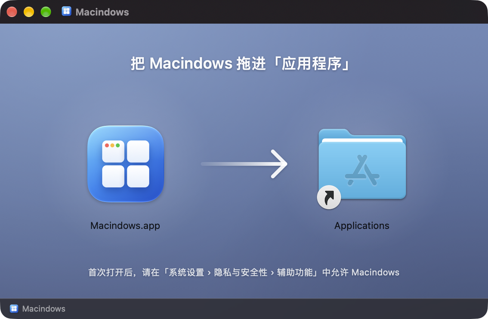

<div align="center">
  
  <h1>Macindows</h1>
  <p><b>A more useful Dock. Just as elegant.</b><br>Hover to see windows. Click to switch.</p>
  <p>
    
    
    
    
  </p>
  <p><a href="README.md">简体中文</a> · <b>English</b></p>
  <p>
    <a href="https://github.com/nickxia1989-pixel/Macindows/releases/latest"><b>Download</b></a> ·
    <a href="#philosophy">Philosophy</a> ·
    <a href="#features">Features</a> ·
    <a href="#install">Install</a> ·
    <a href="#permissions-and-privacy">Permissions and Privacy</a> ·
    <a href="#build-from-source">Build from Source</a>
  </p>
</div>

<p align="center">
  
</p>

## Philosophy

The Dock is beautiful, just not very practical. Macindows fixes that and touches nothing else.

- **Minimal change**: adds hover previews and click-to-switch. It never replaces or modifies the Dock.
- **True to the original**: the Dock looks and works exactly as before. Quit Macindows and everything is back to stock.
- **Nothing leaves your Mac**: it needs system permissions, but there is no network access, no analytics and no account.

## Features

### Hover: every window at a glance

Rest the pointer on any app icon in the Dock:

- **See every window of that app**, whether open, hidden or minimized. Click one to switch to it.
- **One row, in the order the windows were opened.** The order does not change as you switch. With many windows the previews shrink; with even more, the panel becomes a list of titles.
- **Thumbnails are optional.** Without Screen Recording permission the panel shows window titles only, and everything else works the same.
- **Running apps with no windows** get a placeholder card of the same size. Click it to open a new window.
- **Close windows in place** with the close button on each item, or with a middle click.
- **Hard to trigger by accident.** Passing over other icons on the way to the panel does not switch it away.

### Click: the same rules as the Windows taskbar

| State of the app | One click on its icon |
| --- | --- |
| One window, not in front | Switches to that window |
| One window, already in front | Minimizes it |
| One window, minimized | Brings it back |
| Several windows | Shows the window list; click one to switch |
| Not running, or no windows | Left to the Dock, same as stock macOS |

Right-click menus and the Dock's other built-in interactions are still handled by the Dock itself. The panel gets out of the way when a Dock menu opens.

### Menu bar

The four-pane icon in the menu bar lets you pause or enable Macindows, turn window thumbnails on or off, launch at login, check permission status, reveal the log folder, and quit.

## Install

1. Download `Macindows.dmg` from [Releases](https://github.com/nickxia1989-pixel/Macindows/releases/latest).
2. Open it and drag Macindows into Applications.
3. Launch Macindows and, when prompted, allow it under System Settings › Privacy & Security › Accessibility.
4. For window thumbnails, turn on 显示窗口缩略图 (Show window thumbnails) from the menu bar icon, then grant Screen Recording permission.

<p align="center">
  
</p>

The installer is signed with a Developer ID and notarized by Apple, so macOS opens it without a warning.

**Requirements**: macOS 26 or later, on Apple silicon or Intel.

> [!NOTE]
> The app's interface is currently in Simplified Chinese only.

## Permissions and Privacy

| Permission | Required | What it is used for |
| --- | --- | --- |
| Accessibility | Yes | Knowing which Dock icon the pointer is on; listing, switching, minimizing and closing windows; recognizing clicks on Dock icons |
| Screen Recording | Optional | Only for the window thumbnails in the hover panel |

These permissions are broad, so here is exactly what Macindows does with them:

- **No network access.** There are no network requests in the code: no analytics, no crash reporting, no update checks, no account.
- **Thumbnails live in memory only.** They are shown in the hover panel, never written to disk, and never leave your Mac.
- **Only two things are stored locally.** Two preferences (enabled, show thumbnails), and a troubleshooting log in `~/Library/Logs/Macindows/`. The log records app names and window counts, never window titles or images, and is trimmed once it passes roughly 512 KB.
- **The keyboard is not monitored.** Only pointer movement and clicks are observed, and only left clicks that land on a Dock icon are acted on.
- **You can verify all of this.** The full source is in this repository. Check each point above against the code, or build the app yourself.

## How It Works

- **Reading the Dock**: the positions of Dock icons and the apps behind them come from the system Accessibility API. The Dock process itself is never modified or injected into, and System Integrity Protection stays on.
- **The hover panel**: a floating window owned by Macindows, placed above the icon. It is entirely separate from the Dock.
- **Click rules**: clicks on Dock icons are observed and, following the table above, either handled by Macindows or passed back to the Dock untouched.

One caveat: to switch to one specific window precisely, and to produce thumbnails for minimized windows, Macindows relies on a small number of undocumented system interfaces. Each has a fallback, but a major macOS update may require changes. This is also why it cannot be distributed on the Mac App Store.

## Known Limitations

- macOS 26 or later only, because the hover panel uses the Liquid Glass material introduced in that release.
- Fully tested only on macOS 27 with Apple silicon so far. The installer includes an Intel build, but it has not been tested on real hardware.
- A Dock on the side of the screen works, but the spacing between the panel and the Dock's name label is an estimate.
- Windows on other Spaces or in full screen have not been thoroughly verified.
- The interface is in Simplified Chinese only.

## Build from Source

Requires macOS 26 or later and the Xcode Command Line Tools.

```bash
./Scripts/install.sh
```

This builds, bundles and signs the app, copies `Macindows.app` into Applications and launches it. To bundle without installing, run `./Scripts/build-app.sh`; the result is `build/Macindows.app`. Without a development certificate the build is ad-hoc signed. It runs normally, but Accessibility has to be granted again after each rebuild.

The app icon is generated by `swift Scripts/make-icon.swift Resources`. The menu bar icon is drawn in code (`Sources/Macindows/MenuBarIcon.swift`).

<details>
<summary><b>Packaging a distributable disk image</b></summary>

<br>

```bash
./Scripts/release.sh
```

This produces `dist/Macindows.dmg`: a universal build for Apple silicon and Intel, signed with a Developer ID certificate and notarized by Apple. It needs your own Developer ID Application certificate in the keychain, and notarization credentials saved once beforehand:

```bash
xcrun notarytool store-credentials "macindows-notary" --apple-id "<Apple Account email>" --team-id <Team ID>
```

Without saved credentials the script signs but does not notarize. The certificate and credentials live only in your local keychain; this repository contains no signing material.

The layout of the opened disk image (window size, icon positions, background) is written by Finder at the request of `Scripts/make-dmg.sh`, so a Finder window appears briefly during packaging, and macOS asks once for permission to control Finder. The background is generated by `swift Scripts/make-dmg-background.swift Resources`. If you change the layout, update the coordinates in both scripts.

</details>

## Troubleshooting

```bash
swift test                                              # unit tests for the click rules and coordinate math
open -n /Applications/Macindows.app --args --diagnose   # writes ~/Library/Logs/Macindows/diagnose.txt
open -n /Applications/Macindows.app --args --selftest   # simulates a hover (moves the pointer briefly), writes selftest.txt
build/Macindows.app/Contents/MacOS/Macindows --render-sample /tmp/macindows-sample   # renders the panel layout with sample data
```

The running log is at `~/Library/Logs/Macindows/macindows.log`. The output of `--diagnose` includes the titles of your current windows. It also stays on your Mac, so review it before attaching it to an issue.

## Project Layout

| Path | Contents |
| --- | --- |
| `Sources/MacindowsCore` | Pure logic such as the click rules and coordinate math, with unit tests |
| `Sources/Macindows` | The app itself |
| `Scripts` | Build, install and packaging scripts, plus the scripts that draw the icon and the disk image background |
| `Resources` | App icon, `Info.plist`, disk image background |
| `preview` | A web prototype used to compare designs before the app was written, kept for reference |

---

<p align="center"><sub>Macindows is an independent third-party tool, not affiliated with Apple or Microsoft. macOS and Windows are trademarks of their respective owners.</sub></p>
